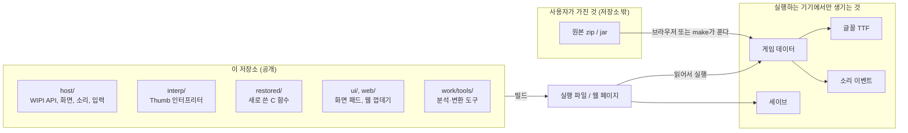
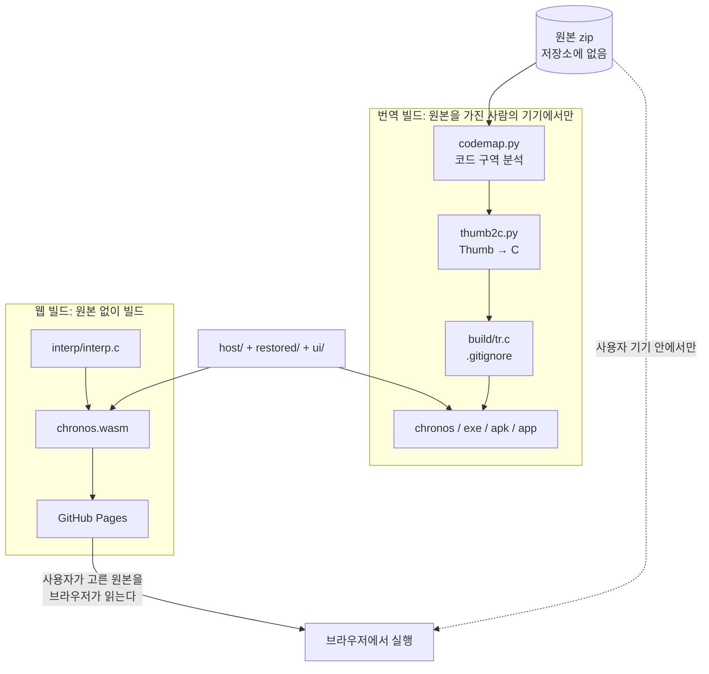
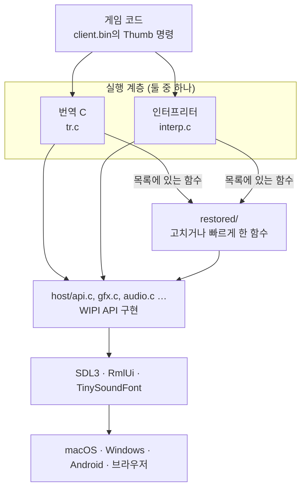

# 크로노스 윙 포트

2009년 KTF 피처폰(WIPI)용 게임 「크로노스 윙」을 요즘 기기에서 돌리는 실행 환경이다. SDL3 위에 WIPI API를 다시 구현했고, 맥·Windows·Android와 브라우저에서 돈다.

> [!IMPORTANT]
> **이 저장소에는 게임이 들어 있지 않다.** 원본 실행 파일, 그림, 소리, 대사, 그리고 거기서 만든 파생물은 저장소에도 커밋 기록에도 배포 페이지에도 없다. 실행하려면 원본 파일(KTF 판 `zip` 또는 `jar`)을 직접 가지고 있어야 한다. 무엇이 어디에 있는지는 [docs/provenance.md](docs/provenance.md)에 적었다.

브라우저 판: <https://ring-experimental.github.io/chronos-wing/>
페이지를 열고 가지고 있는 원본 파일을 고르면 그 기기 안에서 풀어 실행한다. 파일은 어디로도 전송되지 않는다.

## 무엇이 저장소에 있고 무엇이 없는가



## 빌드 종류

| 대상 | 명령 | 게임 코드 실행 방식 | 원본이 필요한 때 | 공개 배포 |
|---|---|---|---|---|
| 웹 | `make web` | 인터프리터 | 실행할 때(사용자가 고름) | 한다 |
| 맥(인터프리터) | `make interp` | 인터프리터 | 실행할 때 | 안 한다 |
| 맥 | `make`, `make mac` | 빌드 때 C로 번역 | 빌드할 때 | 안 한다(결과물에 원본이 들어감) |
| Windows | `make windows` | 빌드 때 C로 번역 | 빌드할 때 | 안 한다 |
| Android | `make android` | 빌드 때 C로 번역 | 빌드할 때 | 안 한다 |



## 빨리 해 보기

웹 빌드는 원본 없이 만들어진다.

```bash
brew install emscripten ninja rustup
cd native
make web                       # 결과: native/build/web
python3 -m http.server -d build/web 8765
```

`http://localhost:8765`을 열고 원본 파일을 고른다. 다른 빌드와 조작법은 [native/README.md](native/README.md)에 있다.

## 구조



- 실행 구조와 메모리 배치: [docs/architecture.md](docs/architecture.md)
- 웹 빌드, 가져오기, 저장, 배포: [docs/web.md](docs/web.md)
- 원본과 같게 도는지 확인하는 방법: [docs/verification.md](docs/verification.md)
- 원본 미포함 원칙과 점검 방법: [docs/provenance.md](docs/provenance.md)

## 폴더

| 경로 | 내용 |
|---|---|
| `native/host/` | WIPI API와 플랫폼 계층. 내장 서버(`localnet*.c`)로 네트워크 모드를 오프라인에서 돌린다 |
| `native/interp/` | Thumb-1 인터프리터와 대조 도구(`compare.sh`) |
| `native/restored/` | 원본 동작을 분석해 새로 쓴 C. 목록은 `list.txt` |
| `native/ui/` | 화면 패드와 설정 창(RmlUi). 그림은 `work/tools/mkskin.py`로 만든 것이다 |
| `native/web/` | 웹 페이지, 원본 가져오기(`gamedata.js`), 서비스 워커 |
| `work/tools/` | 분석과 변환 도구 |
| `work/*.md` | 작업 기록. 분석 과정과 결정이 날짜순으로 남아 있다 |
| `docs/` | 구조와 절차 문서 |

## 작업 기록

| 문서 | 내용 |
|---|---|
| [work/macos-plan.md](work/macos-plan.md) | 원본 감별, 복원 방식 결정, 네이티브 호스트 |
| [work/wipi-api.md](work/wipi-api.md) | 게임이 쓰는 WIPI API 목록 |
| [work/net-offline.md](work/net-offline.md) | 서비스가 끝난 네트워크 모드를 내장 서버로 대신한 기록 |
| [work/turn-plan.md](work/turn-plan.md) | 턴제 모드 |

## 출처

- WIPI API 동작: [WIE](https://github.com/dlunch/wie) (MIT). 소스를 참고해 C로 옮겼고 링크하지 않는다.
- SDL3 (zlib), RmlUi (MIT), FreeType (FTL), TinySoundFont (MIT)
- SMAF 변환: smaf-player (MIT)
- 사운드폰트: 1MGM (CC BY 3.0), `native/third_party/1mgm.txt`

「크로노스 윙」과 그 그림, 소리, 글의 권리는 원 권리자에게 있다. 이 저장소는 그 어느 것도 배포하지 않는다.
