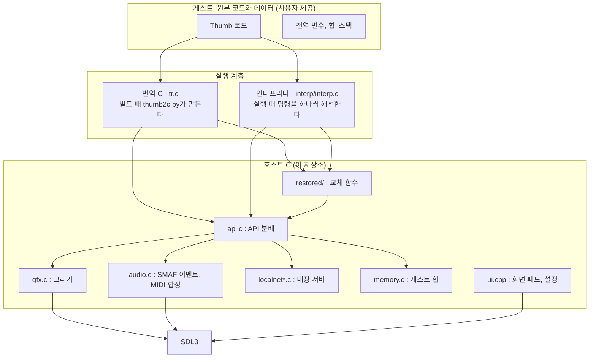
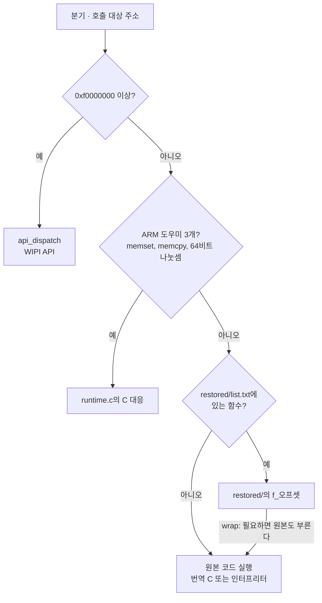
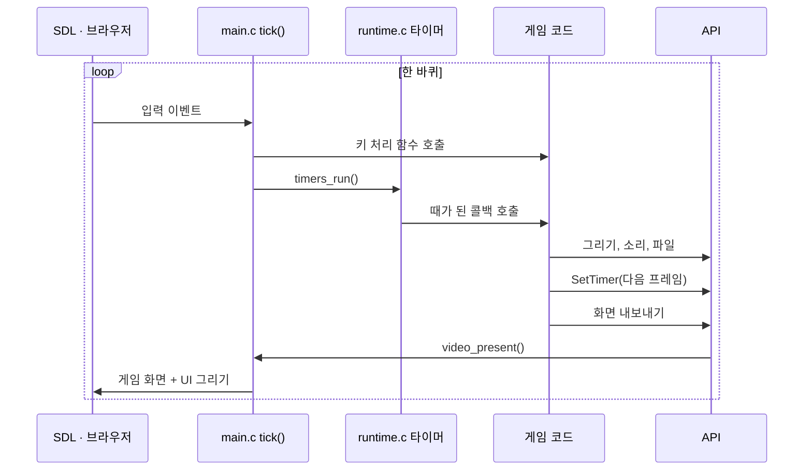
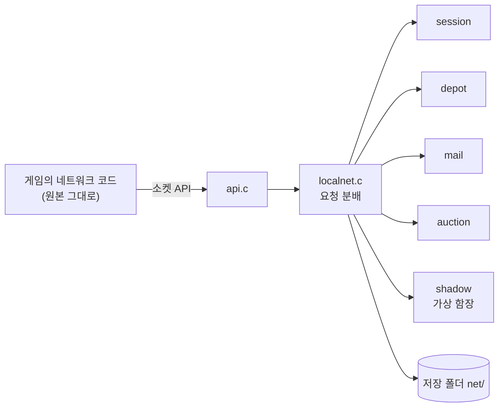

# 실행 구조

원본은 KTF WIPI Clet이다. ARM Thumb 기계어로 된 실행 이미지(`client.bin`) 하나와 데이터 파일들로 이루어져 있고, 단말기의 WIPI API를 불러 화면·소리·파일을 다룬다. 이 포트는 그 실행 이미지를 그대로 돌리면서 API만 새로 구현한다.

> 이 저장소에는 `client.bin`과 데이터 파일이 없다. 아래 설명의 주소는 원본 안의 위치를 가리키는 값이다. → [provenance.md](provenance.md)

## 계층



번역 빌드와 인터프리터 빌드는 실행 계층만 다르다. 나머지 소스는 같고, 두 빌드가 같은 결과를 내는지는 [verification.md](verification.md)의 방법으로 확인한다.

| | 번역 C | 인터프리터 |
|---|---|---|
| 만드는 때 | 빌드할 때 원본이 있어야 한다 | 원본 없이 빌드된다 |
| 결과물 | 원본 코드가 들어간다 | 원본이 들어가지 않는다 |
| 속도 | 빠르다 | 느리다. 무거운 함수는 `restored/`로 옮겨 메운다 |
| 쓰는 곳 | 맥, Windows, Android | 웹, 대조용 맥 빌드 |

## 게스트 메모리

게스트 주소는 32비트이고 호스트는 `cpu.m + 주소`로 접근한다(`host/host.h`).

| 주소 | 내용 |
|---|---|
| `0x100000` | 실행 이미지. 시작할 때 재배치 표와 GOT를 고친다(`main.c`의 `load_image`) |
| `0x220000` | 호스트가 채우는 API 표 |
| `~0x400000` | 스택(아래로 자란다) |
| `0x400000 ~ 0x4000000` | 힙(`memory.c`) |
| `0xf0000000 ~` | API 호출 주소. 실제 메모리가 아니고 분기 대상으로만 쓴다 |

네이티브 빌드는 4GB를 예약하고 게스트 영역만 열어 잘못된 접근을 보호 페이지로 잡는다. 웹에는 보호 페이지가 없어 인터프리터와 `restored/`가 접근마다 범위를 검사한다(`thumbrt.h`의 `CK`).

## 호출이 가는 길

게임 코드가 다른 곳으로 분기하면 대상 주소에 따라 갈린다.



`restored/list.txt`의 한 줄이 함수 하나다. `wrap`이 붙으면 원본을 `orig_f_<오프셋>`으로 남겨 새 함수가 부를 수 있다. 붙지 않으면 원본은 쓰이지 않는다.

```
45b5c devmode.c          # 원본을 완전히 대신한다
a328 blit.c wrap         # 원본을 남겨 둔다(자체 검사와 예외 경로에서 부른다)
```

호스트가 게임 함수를 부를 때는 `guest_call(주소, 인자…)`를 쓴다. 인자 넷은 `r0~r3`, 나머지는 게스트 스택에 놓는다.

## 메인 루프

WIPI Clet은 타이머 콜백으로 돈다. 게임이 `SetTimer`로 다음 프레임을 예약하면 호스트가 때가 됐을 때 콜백을 부른다.



네이티브는 다음 타이머까지 자고, 웹은 브라우저의 화면 주기마다 `tick()`이 한 번 불린다(`main.c`의 `web_tick`).

## `restored/`가 하는 일

| 종류 | 예 |
|---|---|
| 넓은 화면 대응 | `title.c`, `worldmap.c`, `hud.c` |
| 원본 버그 수정 | `animframe.c`(표 밖 읽기), `bag.c` |
| 새 기능 | `dialog.c`(자동 넘기기, 기록), `replay.c`, `music.c`, `devmode.c`, `turn*.c` |
| 인터프리터 속도 | `blit.c`(그리기 루프), `crypt.c`(DES 라운드) |

속도 때문에 옮긴 함수는 원본과 바이트 단위로 같은 결과를 내야 한다. 확인 방법은 [verification.md](verification.md)에 있다.

## 서비스가 끝난 네트워크 모드

게임의 네트워크 모드는 서버가 없어져 막혀 있었다. `host/localnet*.c`가 소켓 API를 받아 프로세스 안에서 응답해 대신한다. 근거와 정한 값은 [work/net-offline.md](../work/net-offline.md)에 있다.


