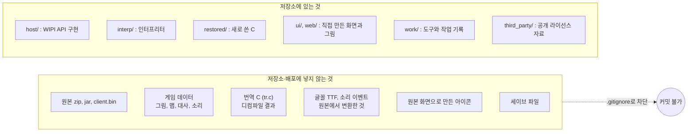
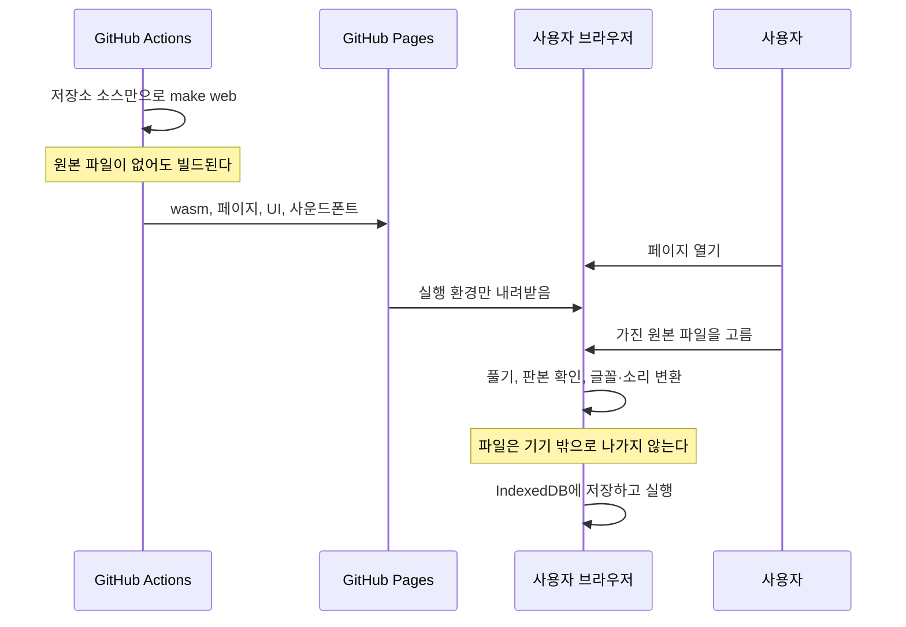

# 원본 미포함 원칙

이 저장소와 배포 페이지에는 게임 원본도, 원본에서 만든 파생물도 없다. 이 문서는 그 경계가 어디인지, 어떻게 지키고 어떻게 확인하는지 적는다.

## 경계



## 산출물마다

| 산출물 | 어디서 나오나 | 어디에 있나 | 저장소 | 웹 배포 |
|---|---|---|---|---|
| `크로노스윙.zip`, `010100D2.jar` | 사용자가 가진 원본 | 저장소 루트(개인 작업 폴더) | 없음 | 없음 |
| `client.bin`, 게임 데이터 폴더 | 원본을 푼 것 | `native/build/game`, 브라우저 저장소 | 없음 | 없음 |
| `tr.c` | `thumb2c.py`가 `client.bin`을 번역 | `native/build` | 없음 | 없음 |
| `codemap.json` | `codemap.py`의 분석 결과 | `native/build` | 없음 | 없음 |
| `ChronosGame.ttf` | 게임 비트맵 글꼴을 변환 | `native/build/ui`, 브라우저 저장소 | 없음 | 없음 |
| `game.ev` | 게임 소리(SMAF)를 변환 | `native/build`, 브라우저 저장소 | 없음 | 없음 |
| 런처 아이콘(Android) | 타이틀 화면에서 만듦 | `native/build/android` | 없음 | 없음 |
| Ghidra 프로젝트, 디컴파일, 화면 캡처 | 분석 중간물 | `work/ghidra`, `work/decomp`, `work/shots` | 없음 | 없음 |
| 세이브 | 플레이 결과 | `work/saves`, 브라우저 저장소 | 없음 | 없음 |
| `chronos.wasm` | 저장소의 소스만으로 빌드 | `native/build/web` | 없음(빌드 결과) | 있음 |
| 화면 패드 그림 | `work/tools/mkskin.py`가 도형으로 그림 | `native/ui/*.png` | 있음 | 있음 |
| 웹 아이콘 | 새로 그린 SVG | `native/web/icon.*` | 있음 | 있음 |
| 사운드폰트 1MGM | 공개 자료(CC BY 3.0) | `native/third_party` | 있음 | 있음 |

## `restored/`에 대해

`native/restored/`의 C는 원본 바이너리의 동작을 분석해 새로 쓴 코드다. 원본의 기계어나 그것을 기계 번역한 C를 옮겨 적은 것이 아니다. 다만 원본 안의 위치를 가리키는 값은 들어 있다.

- 함수 주소와 전역 변수 주소(예: `0x105b8c`, `GOT + 0x100`)
- 구조체 필드 오프셋
- 기능 설명에 필요한 짧은 식별 값(동료 번호, 스토리 변수 번호 같은 것)

이 값들만으로는 게임이 되지 않는다. 실행에는 언제나 사용자가 가진 원본 파일이 필요하다.

`work/*.md`의 작업 기록도 같다. 주소, 구조, 수치 관찰을 적었고 원본 파일이나 그 덤프는 싣지 않았다.

## 웹 배포가 원본 없이 되는 이유



배포 워크플로(`.github/workflows/pages.yml`)는 깨끗한 러너에서 저장소만 받아 빌드한다. 원본이 있어야만 빌드되는 것이 섞이면 이 빌드가 실패하므로, 워크플로가 통과한다는 것이 곧 원본 없이 만들어졌다는 확인이다.

## 지키는 장치

- `.gitignore`가 원본과 파생물의 이름과 폴더를 막는다.
- 번역 빌드의 결과(`native/build`)는 통째로 제외한다.
- 웹 빌드는 번역 C를 쓰지 않는다. 인터프리터 연결 파일(`interp_gen.c`)은 `restored/list.txt`와 소스의 함수 이름만 읽어 만든다(`work/tools/interpgen.py`).
- 웹 페이지의 가져오기(`native/web/gamedata.js`)에는 원본을 식별하는 SHA-256 값 하나만 들어 있다.

## 직접 확인하기

커밋 기록 전체에서 소스와 문서가 아닌 파일을 찾는다.

```bash
git log --all --format= --name-only | sort -u \
  | grep -viE '\.(c|h|cpp|py|md|sh|rml|rcss|txt|java|rs|toml|xml|plist|rc|manifest|js|html|yml|svg|webmanifest)$|Makefile|\.gitignore'
```

나와야 하는 것은 `native/ui/*.png`, `native/web/icon-*.png`, `native/third_party/1mgm.sf2`뿐이다.

막아 둔 이름이 추적되고 있지 않은지 본다.

```bash
git ls-files | grep -E '\.(zip|jar)$|client\.bin|/build/|work/(bin|decomp|ghidra|shots|wide|saves)/'   # 아무것도 나오지 않아야 한다
```

## 기여할 때

- 원본 파일, 화면 캡처, 추출한 그림과 소리, 대사 전문, 세이브 파일을 커밋하지 않는다.
- 이슈나 PR에 원본 파일이나 내려받을 주소를 올리지 않는다.
- 빌드 결과를 커밋하지 않는다.
- 새 그림이 필요하면 직접 만든다. 원본 그림을 손봐서 쓰지 않는다.
