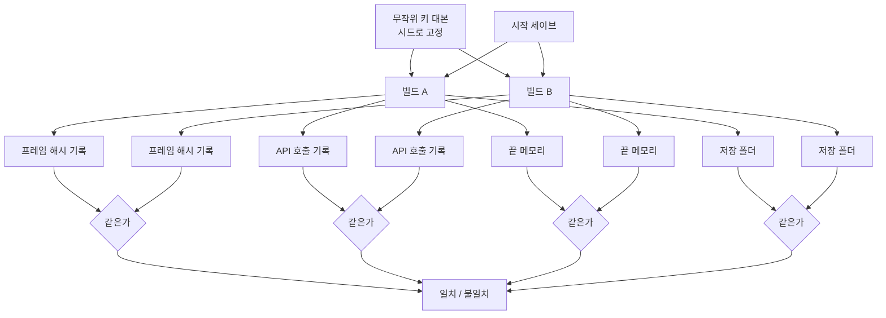
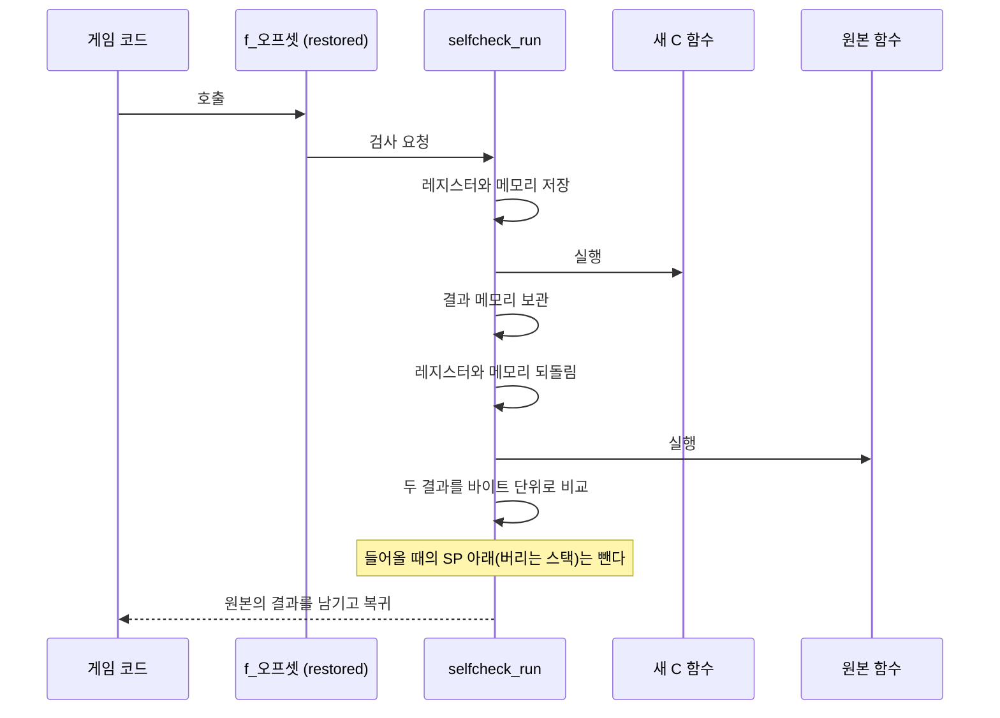
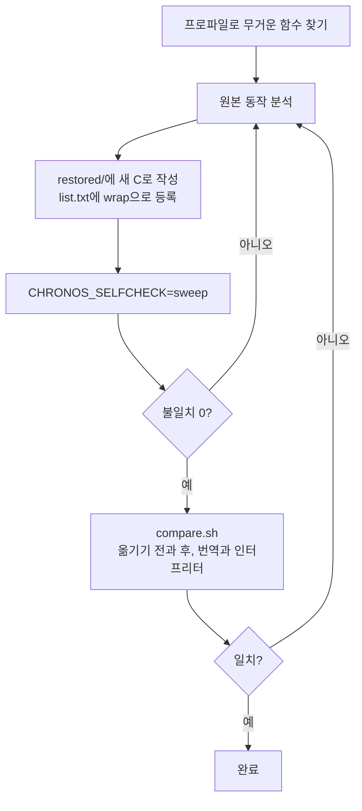

# 검증

게임 코드를 다른 방식으로 실행하거나(인터프리터) 함수를 새 C로 바꿔도(`restored/`) 원본과 같게 돌아야 한다. 확인하는 방법은 두 가지다.

> 검증에는 원본 파일이 필요하다. 저장소에는 도구만 있고 원본과 세이브는 없다. → [provenance.md](provenance.md)

| 방법 | 견주는 단위 | 쓰는 때 |
|---|---|---|
| 전체 실행 대조 `interp/compare.sh` | 빌드 두 개를 같은 입력으로 끝까지 실행 | 실행 계층을 바꿨을 때, 무엇이든 고친 뒤 |
| 자체 검사 `CHRONOS_SELFCHECK` | 함수 호출 하나 | 함수를 `restored/`로 옮겼을 때 |

## 전체 실행 대조

두 실행 파일을 같은 세이브, 같은 키 대본, 같은 시계로 돌리고 네 가지를 견준다.



```bash
cd native
make all interp
SAVE_FROM=<세이브 폴더> interp/compare.sh <출력 폴더> <가상 초> [시드]
BINS="chronos chronos" interp/compare.sh out 60        # 같은 빌드 두 번: 재현되는지
DATA_ONLY=1 BINS="chronos-base chronos" interp/compare.sh out 60   # 함수를 옮기기 전과 후
```

실행마다 결과가 같으려면 시계가 실행 속도와 무관해야 한다. 그래서 세 가지를 켠다.

| 환경 변수 | 하는 일 |
|---|---|
| `CHRONOS_VCLOCK` | 타이머 시계를 가상으로 돌린다. 기다릴 만큼 건너뛰고 콜백마다 1ms 흐른다 |
| `CHRONOS_FAKE_TIME` | 게임이 읽는 현재 시각을 호출마다 5씩 늘린다 |
| `CHRONOS_SCRIPT` | 가상 시각에 맞춰 키를 넣는다 |

견주는 것은 다음과 같다.

| 항목 | 내용 |
|---|---|
| 프레임 기록 | 표시한 프레임마다의 해시(`CHRONOS_FRAMELOG`). 픽셀 하나만 달라도 어긋난다 |
| API 기록 | 호출한 API와 복귀 주소의 순서(`CHRONOS_TRACE`) |
| 끝 메모리 | 대본이 끝난 순간의 게스트 데이터 영역 |
| 저장 폴더 | 게임이 쓴 세이브 파일 |

함수를 `restored/`로 옮기면 원본이 스택에 남기던 찌꺼기가 달라진다. 그 비교에는 `DATA_ONLY=1`로 스택 앞까지만 견준다.

### 결과

번역 빌드와 인터프리터 빌드(2026-11-17~18).

| 시작 상태 | 가상 시간 | 프레임 | API 호출 | 결과 |
|---|---|---|---|---|
| 새 세이브 | 60초 | 1,331 | 65,314 | 일치 |
| 전투 세이브 | 120초 | 2,654 | 136,703 | 일치 |
| 월드맵 세이브 | 90초 | 2,065 | 196,716 | 일치 |
| 턴제 시험 세이브 | 90초 | 1,935 | 188,726 | 일치(끝 메모리 없음) |
| 전투 세이브 + 턴제 | 60초 | 1,851 | 398,439 | 일치 |

무작위 키로는 스토리 진행, 상점, 네트워크 모드를 거의 밟지 못한다. 새 세이브는 닉네임 입력을 넘지 못해 타이틀과 메뉴까지만 돈다.

## 자체 검사

함수 하나를 옮겼을 때, 그 함수가 불릴 때마다 원본과 결과를 맞댄다(`restored/selfcheck.c`).



```bash
CHRONOS_SELFCHECK=1 build/chronos build/game --windowed       # 실제 호출만
CHRONOS_SELFCHECK=sweep build/chronos build/game --windowed   # 그리기 함수는 인자를 바꿔 가며 더 견준다
```

`sweep`은 실제로 그려진 이미지를 써서 방향(-1~9), 시작 칸의 홀짝, 크기(0 이하 포함), 불투명도 6종, 혼합 방식 3종을 모두 돌린다. 플레이만으로는 나오지 않는 경우를 메우기 위한 것이다. 종료할 때 갈래별 호출 수와 불일치 수를 적는다.

### 결과

속도 때문에 옮긴 함수 넷(2026-11-18).

| 원본 | 옮긴 곳 | 내용 |
|---|---|---|
| `0x5b8c` | `crypt.c` | DES 16라운드 |
| `0x69f4` | `blit.c` | 반투명 사각형 채우기 |
| `0xa328` | `blit.c` | 팔레트 이미지 그리기 |
| `0xb80c` | `blit.c` | 팔레트 이미지 그리기 + 색 혼합 |

| 시작 상태 | 견준 호출 | 불일치 |
|---|---|---|
| 전투 세이브 | 28,065 | 0 |
| 월드맵 세이브 | 27,997 | 0 |
| 턴제 시험 세이브 | 27,993 | 0 |
| 새 세이브 | 27,989 | 0 |

이 검사가 찾아낸 차이 두 가지는 고쳤다. 원본의 채우기 함수는 잘라 낸 높이를 호출한 쪽 스택 인자 칸에 되쓰고, 4비트 그리기는 혼합 없는 방향 0에서 폭이 0 이하일 때 줄 시작을 이어서 계산한다.

원본에 그대로 맡긴 경로가 둘 있다. 화면이 RGB565가 아닐 때의 채우기와, 순열 표가 정상 범위를 벗어난 DES다. 둘 다 이 호스트에서는 실행되지 않는다.

## 속도

인터프리터 빌드, 같은 대본 기준이다.

| | 전투 120초 | 월드맵 90초 |
|---|---|---|
| 옮기기 전 명령 수 | 169억 | 84억 |
| 옮긴 뒤 명령 수 | 30억 | 24억 |
| 옮기기 전 게스트 실행 | 52.6초 | 27.6초 |
| 옮긴 뒤 게스트 실행 | 16.1초 | 11.7초 |

어느 함수가 무거운지는 `-DINTERP_PROF`로 인터프리터를 빌드하고 `CHRONOS_INTERP_PROF=<파일>`로 실행하면 명령 주소별 횟수가 남는다.

## 함수를 옮기는 순서


