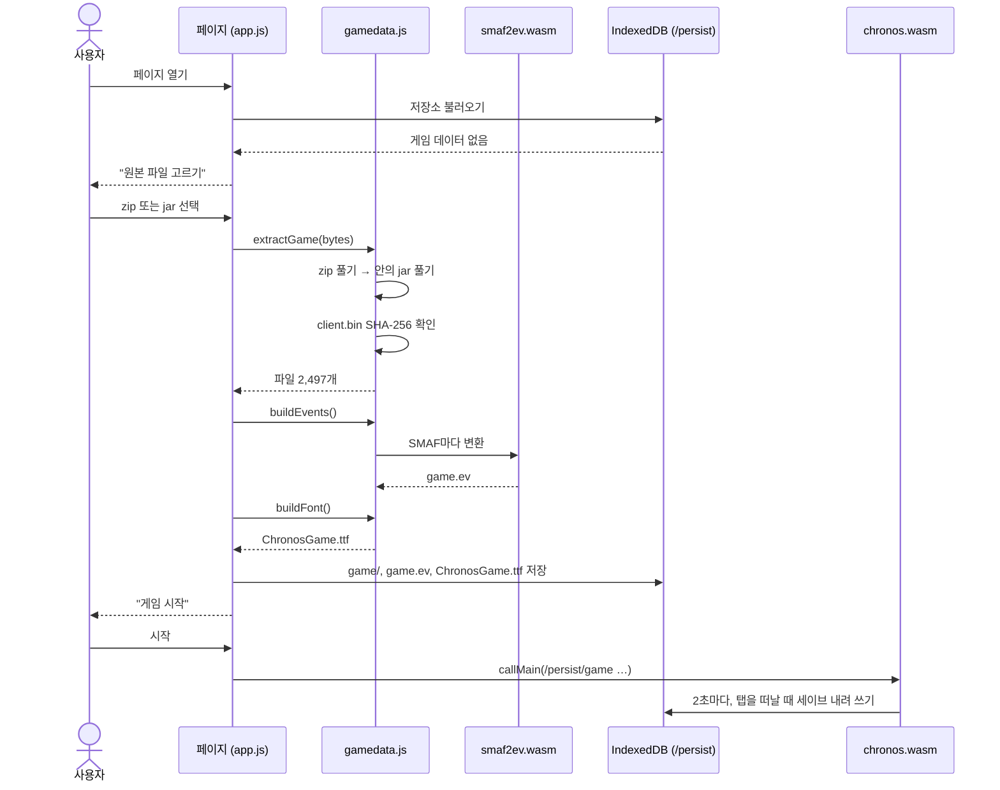
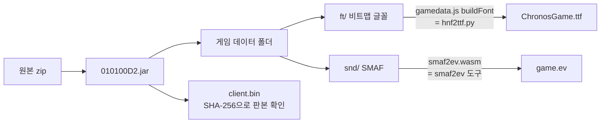
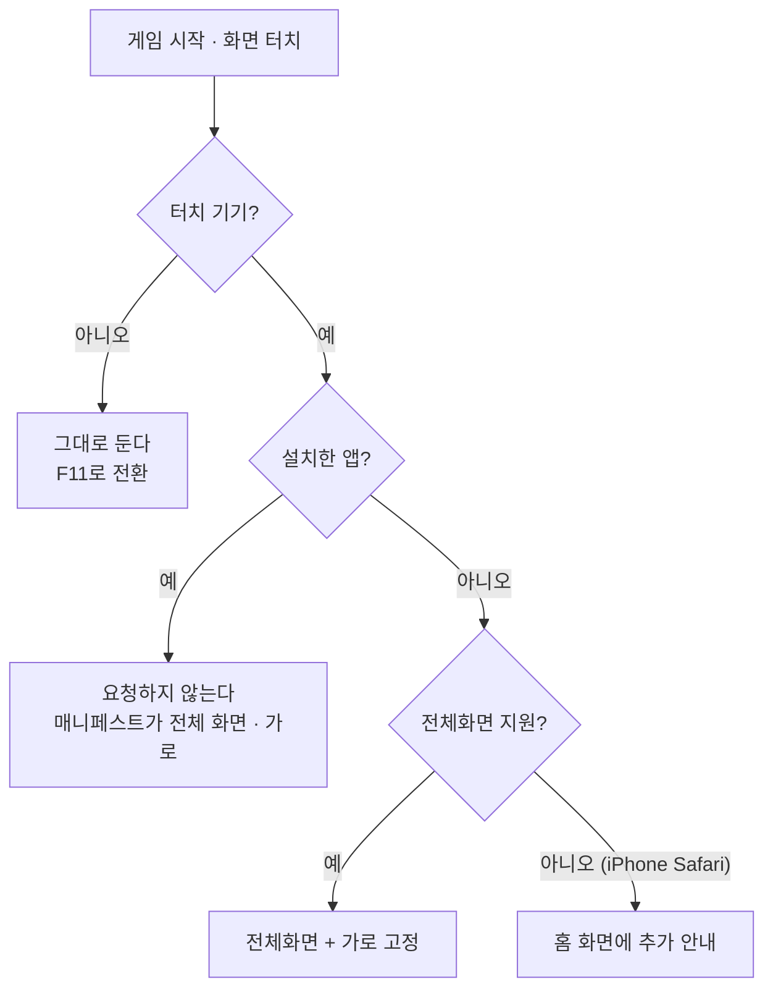
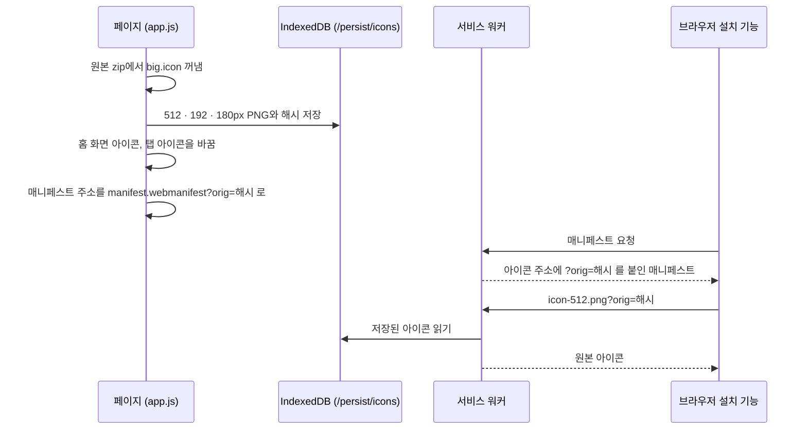
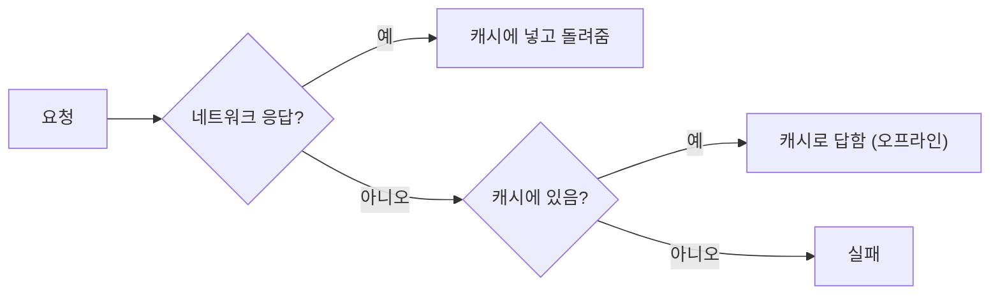
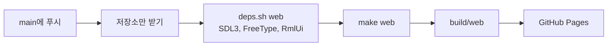

# 웹 빌드

브라우저에서 도는 판이다. 페이지에는 실행 환경만 있고, 게임은 사용자가 가진 원본 파일을 브라우저가 직접 읽어 실행한다.

> 배포되는 파일 어디에도 원본과 그 파생물이 없다. → [provenance.md](provenance.md)

## 빌드

```bash
brew install emscripten ninja rustup    # rustup target add wasm32-unknown-unknown
cd native
make web                                # 처음에는 deps.sh web이 SDL3, FreeType, RmlUi를 받아 빌드한다
python3 -m http.server -d build/web 8765
```

`native/build/web`이 결과다. 이 폴더를 그대로 정적 호스팅에 올리면 된다.

| 파일 | 내용 |
|---|---|
| `index.html`, `app.js` | 페이지와 진행(저장소 연결, 가져오기, 시작) |
| `gamedata.js` | 원본 풀기, 글꼴과 소리 변환 |
| `chronos.js`, `chronos.wasm` | 호스트 + 인터프리터 |
| `chronos.data` | 화면 패드 UI와 사운드폰트 |
| `smaf2ev.wasm` | SMAF 변환기(`work/tools/smaf2ev`) |
| `sw.js`, `manifest.webmanifest`, `icon*` | PWA |

## 처음 열 때



두 번째부터는 저장된 데이터를 바로 쓰므로 `게임 시작`만 누르면 된다.

## 가져오기가 만드는 것

빌드 때 파이썬과 Rust 도구로 만들던 파생물을 브라우저에서 같은 규칙으로 만든다.



네이티브 빌드의 결과와 맞대어 확인했다.

| 항목 | 대조 결과 |
|---|---|
| 푼 파일 | 2,497개 모두 같음 |
| `game.ev` | 바이트 단위로 같음 |
| 글꼴 | 글리프 2,448자의 윤곽, 폭, 문자 대응이 같음 |

지원하는 원본은 KTF 판 하나다. 다른 통신사 판은 실행 이미지가 달라 `restored/`의 주소가 맞지 않으므로 거부한다.

## 저장소 배치

Emscripten의 가상 파일 시스템 위에서 돈다.

| 경로 | 저장 | 내용 |
|---|---|---|
| `/ui`, `/1mgm.sf2` | 배포 꾸러미(`chronos.data`) | 화면 패드, 사운드폰트 |
| `/persist/game/` | IndexedDB | 원본에서 푼 게임 데이터 |
| `/persist/game.ev`, `/persist/ChronosGame.ttf` | IndexedDB | 가져올 때 만든 파생물 |
| `/persist/icons/` | IndexedDB | 원본 zip의 아이콘으로 만든 설치 아이콘 |
| `/persist/save/` | IndexedDB | 세이브 |
| `/persist/ui.ini` | IndexedDB | 패드 배치, 키 설정 |
| `/tmp/` | 메모리 | 세이브 내보내기·들여오기의 임시 파일 |

브라우저 데이터를 지우면 `/persist`가 통째로 사라진다. 세이브는 타이틀의 `캐릭터 관리` → `캐릭터 복구`에서 파일(`.cwsave`)로 내보낼 수 있다. 웹에서는 내보내기가 내려받기로, 들여오기가 파일 고르기 화면으로 바뀐다(`host/savefile.c`).

## 네이티브와 다른 점

| 항목 | 네이티브 | 웹 |
|---|---|---|
| 게임 코드 | 번역 C | 인터프리터 |
| 메인 루프 | 다음 타이머까지 잔다 | 화면 주기마다 한 번(`web_tick`) |
| 메모리 보호 | 보호 페이지 | 접근마다 범위 검사 |
| 파일 창 | OS 파일 창 | 페이지의 고르기 화면, 내려받기 |
| 게임 화면 폭 | 모니터 비율(240~640) | 시작할 때의 페이지 비율(240~640). 터치 기기는 세로로 든 채 시작해도 가로 비율로 잡고, 세로인 동안 돌리라는 안내를 띄운다 |
| 전체화면 | 기본 전체화면, F11 | 터치 기기는 시작할 때 전체화면 + 가로 고정, 데스크톱은 F11 |
| 종료 | 프로세스 종료 | 저장 후 "다시 시작" 화면 |

## 설치(PWA)와 전체화면

폰 브라우저는 주소창과 내비게이션 바 때문에 게임 화면이 작아진다. 두 가지로 줄인다.

- **브라우저 전체화면**: 터치 기기는 `게임 시작`을 누를 때 전체화면으로 들어가 가로로 고정한다. 뒤로 제스처로 빠져나오면 다음 터치 때 다시 들어간다. 데스크톱은 F11로 오간다(게임이 키를 가져가므로 페이지가 처리한다).
- **앱으로 설치**: 매니페스트가 `fullscreen`, `landscape`라 설치한 앱은 처음부터 전체 화면이다. 이때는 브라우저 전체화면을 요청하지 않는다(요청하면 Chrome이 종료 안내를 띄운다). 이 건너뛰기는 터치 화면에만 둔다. 데스크톱의 F11 상태도 같은 표시로 잡히기 때문이다.



게임 화면 폭은 시작할 때 한 번 정해진다. 터치 기기를 세로로 든 채 시작해도 가로로 돌렸을 때의 비율로 잡고, 세로인 동안에는 "화면을 가로로 돌려 주세요"를 띄운다. 원본 가져오기 화면은 세로에서도 쓸 수 있다.

iPhone과 iPad의 Safari에서는 가져오기 화면에 `홈 화면에 추가` 안내가 뜬다. 설치하면 화면을 꽉 채우고, 오래 열지 않았을 때 Safari가 저장소를 지우는 것을 피한다. 설치한 앱의 저장소는 Safari와 따로라서 원본 파일과 세이브는 설치한 앱에서 넣어야 한다.

### 설치 아이콘

배포 파일의 아이콘은 새로 그린 임시 그림이다. 사용자가 원본 zip을 넣으면 그 안의 아이콘(`big.icon`)을 설치 아이콘으로 쓴다. 이 아이콘은 그 기기의 저장소에만 있다.



- 도트가 뭉개지지 않게 정수배로 키워 가운데에 놓고, 둘레는 그림의 가장자리 색으로 채운다.
- 매니페스트와 아이콘 주소는 http(s) 그대로다. `blob:`이나 `data:` 주소면 Android Chrome이 앱 설치 대신 바로가기만 만든다.
- 주소에 해시를 붙이는 것은 브라우저가 매니페스트와 아이콘을 다시 읽게 하려는 것이다.
- 서비스 워커가 아직 없거나 아이콘이 저장되지 않았으면 임시 아이콘으로 설치된다. 설치 자체는 언제나 된다.
- 원본 zip을 먼저 넣은 뒤 설치해야 원본 아이콘이 쓰인다. jar만 넣으면 아이콘이 없어 임시 아이콘이 쓰인다.
- iOS는 홈 화면에 추가하는 순간의 아이콘만 쓴다.

## 오프라인과 갱신

서비스 워커(`sw.js`)는 실행 환경 파일만 캐시한다. 게임 데이터와 세이브는 IndexedDB에 있고 캐시에 넣지 않는다. 네트워크를 먼저 쓰고 실패하면 캐시로 답하므로, 새 빌드는 다음에 열 때 바로 적용되고 한 번 연 뒤에는 오프라인으로도 열린다. 서비스 워커는 https나 `localhost`에서만 돈다.



## 배포

`main`에 푸시하면 GitHub Actions가 빌드해 Pages에 올린다(`.github/workflows/pages.yml`).



러너에는 원본이 없다. 원본이 있어야 빌드되는 것이 섞이면 이 단계가 실패한다.

## 시험용 주소 인자

| 인자 | 동작 |
|---|---|
| `?touch=1` | 터치 기기가 아니어도 화면 패드를 켠다 |
| `?width=<폭>` | 게임 화면 폭을 정한다(240~640) |

## 확인한 것과 못 한 것

맥의 크롬 계열 브라우저에서 가져오기, 타이틀, 필드, 화면 패드, 저장 유지, 서비스 워커를 확인했다. 폰 크기와 터치를 흉내 낸 상태에서 전체화면 진입·재진입, 세로 안내, 설치 아이콘이 매니페스트와 아이콘 요청에 반영되는 것을 확인했다. 폰 실기기에서의 앱 설치와 아이콘, iOS Safari, 한글 입력, 세이브 내보내기·들여오기 화면, 종료 흐름은 아직 확인하지 않았다.
