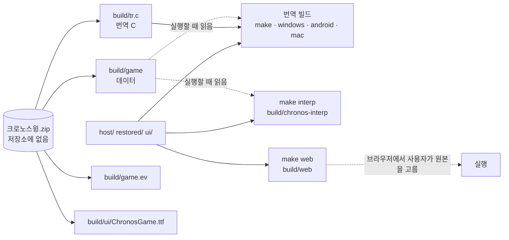

# 크로노스 윙 네이티브 빌드

> 이 저장소에는 게임 원본과 그 파생물이 없다. 번역 빌드(`make`, `windows`, `android`, `mac`)는 원본 `크로노스윙.zip`을 가진 사람이 저장소 루트에 두고 돌리며, 결과물(`build/`)에는 원본이 들어가므로 올리지 않는다. 웹 빌드(`make web`)는 원본 없이 빌드된다. → [docs/provenance.md](../docs/provenance.md)



구조는 [docs/architecture.md](../docs/architecture.md), 웹은 [docs/web.md](../docs/web.md), 검증은 [docs/verification.md](../docs/verification.md)에 있다.

WIE와 ARM 에뮬레이터 없이 도는 SDL3 빌드다. 게임 코드는 `client.bin`을 기계 번역한 C이고, 수정한 함수만 `restored/`의 읽는 C로 교체한다(목록은 `restored/list.txt`). WIPI API는 `host/`에서 직접 구현한다.

```bash
make -j8                                   # 저장소 루트의 크로노스윙.zip이 필요하다
build/chronos build/game                   # 전체화면(폭은 모니터 비율, 240~640). --windowed, --width <폭>, --save <폴더>, F11 전환
```

필요한 도구(맥 기준): `brew install sdl3 cmake ninja uv`와 Rust(`cargo`). 이 기계에만 맞는 경로는 빌드 파일에 적지 않는다. 도구는 PATH에서 찾고, 다른 곳에 있으면 변수로 넘긴다.

| 무엇 | 판이 적힌 곳 | 다른 경로를 쓸 때 |
|---|---|---|
| 파이썬 도구(capstone, fonttools, pillow) | 저장소 루트 `pyproject.toml`, `uv.lock` | `make PY=<파이썬>` |
| FreeType, RmlUi, SDL3(web, android, windows) | `deps.sh`(판과 sha256). 없으면 받아 `build/deps`에 둔다 | |
| SDL3(맥) | 설치된 것. pkg-config, 없으면 `brew --prefix` | `make SDL_CFLAGS=... SDL_LIBS=...` |
| 원본 zip | 저장소 루트의 `크로노스윙.zip` | `make ZIP=<경로>` |
| Android SDK, NDK, JDK | NDK 27.2, build-tools 35, JDK 21 | `ANDROID_HOME`, `ANDROID_NDK_HOME`, `JAVA_HOME` |

키: 방향키, Space/Enter=OK, Shift 좌/우=소프트키, Backspace=CLEAR, 123/QWE/ASD/ZXC=숫자 키패드. 입력 칸(닉네임, 편지, 검색)이 열리면 키보드는 글자 입력이 되고 OS 입력기로 한글을 친다. 방향키, Enter, Backspace만 게임으로 간다. Android는 화면 키보드가 뜬다.

## Windows, Android

SDL3 패키지는 `deps.sh`가 `build/deps`에 받는다(Windows는 mingw 개발 패키지를 `mingw/`, Android는 소스를 `src/`).

```bash
make windows   # build/win 폴더 통째로 옮겨 chronos.exe 실행. 실행 파일 옆 game 폴더를 쓴다
make android   # build/android/chronos.apk(arm64, android/chronos.keystore 서명). adb install로 설치
make mac       # build/mac/ChronosWing.app(arm64, 임시 서명)과 옮기기용 zip. 게임 데이터와 라이브러리가 들어 있어 단독 실행된다
```

Android는 첫 실행 때 APK 안의 데이터를 푼다. 뒤로 키는 CLEAR다.

## 웹

```bash
brew install emscripten
make web       # build/web 폴더를 통째로 올린다. 의존성(SDL3, FreeType, RmlUi)은 처음에 deps.sh web이 만든다
make interp    # 같은 인터프리터의 맥 빌드(build/chronos-interp). interp/compare.sh로 번역 빌드와 대조한다
```

웹 빌드에는 원본에서 나온 것이 없다. 번역 C 대신 Thumb 인터프리터(`interp/interp.c`)가 `client.bin`을 직접 실행하고, 게임 데이터와 글꼴, 소리 이벤트는 사용자가 페이지에서 고른 원본 파일(KTF 판 zip 또는 jar)로 브라우저가 만든다(`web/gamedata.js`). 데이터와 세이브는 브라우저 저장소(IndexedDB, `/persist`)에 있고 세이브 내보내기는 내려받기, 들여오기는 파일 고르기 화면이다. 서비스 워커(`web/sw.js`)는 앱 껍데기만 캐시하며(네트워크 우선) https나 localhost에서만 돈다. 터치 기기는 시작할 때 전체화면과 가로 고정을 요청하고, 앱으로 설치하면 넣은 원본의 아이콘이 쓰인다([docs/web.md](../docs/web.md)). 시험용 주소 인자는 `?touch=1`(화면 패드), `?width=<폭>`이다.

인터프리터가 느린 함수는 `restored/`로 옮긴다(`blit.c`, `crypt.c`). `CHRONOS_SELFCHECK=1`(또는 `sweep`)로 실행하면 옮긴 함수와 원본을 호출마다 견준다(`restored/selfcheck.c`).

## UI

게임 위에 얹는 UI는 RmlUi(`host/ui.cpp`, 문서 `ui/`)다. 터치 패드는 Android 기본, 데스크톱은 `--touch` 또는 설정에서 켠다. F1이나 패드의 `설정`으로 크기, 투명도, 위치를 바꾸며 `ui.ini`에 저장된다. 스킬 슬롯 1, 3, 0은 구매해야 보이고 위치 편집에서 하나씩 옮긴다. 옮기기 전에는 L 버튼 왼쪽에 줄지어 있다. 표시 조건은 데이터 모델 `ui`의 `dialog`, `log`, `edit`, `pad_on`에 묶여 있다. 대사 중에는 OK 대신 화면 하단 어디든 누르면 넘어가고 `SKIP`, `AUTO`, `LOG`만 남는다. `AUTO`(키보드 Tab)는 글이 다 나오면 글 길이에 맞춰 기다렸다가 넘기며 켜진 상태가 `ui.ini`에 남는다. `LOG`(키보드 L)는 게임을 멈추고 현재 스토리의 대사를 게임 창틀로 보여 준다. 위아래로 한 줄, 좌우로 다섯 줄 움직이고 터치는 끌어서 넘긴다. 코드는 `restored/dialog.c`다. 의존성은 처음 빌드 때 `deps.sh`가 만든다.

게임패드는 `host/gamepad.c`가 처리한다. 연결하면 설정 창에 `게임패드 키 설정`(`ui/gamepad.rml`)이 나타나고, 맵핑은 `ui.ini`의 `bind` 줄에 남는다. 왼쪽 스틱은 언제나 이동이고, 설정 창은 맵핑과 상관없이 D패드(또는 스틱), 아래 버튼(확인), 오른쪽 버튼(닫기)으로 다룬다. 도움말 기본 조작과 스킬 설명, 팁, 스킬 커맨드 창은 마지막에 쓴 장치(패드, 키보드)의 키로 바꿔 보여 준다(`gamepad_resource`, `skill_sync`). PS 패드는 X, ○, □, △로 표시하며 `□ △`는 게임 글꼴의 `` ` ``, `^` 자리에 그려 넣는다. 터치를 쓰면 원문 그대로다. 맵 대사의 `5키` 같은 표현과 게임 HUD의 `*`, `#` 표시는 바꾸지 않는다. 시험은 `SDL_JOYSTICK_ALLOW_BACKGROUND_EVENTS=1`로 띄우고 제어 파일에 `vpad xbox|ps`, `vbtn <이름> [up]`, `vaxis <이름> <값>`, `vdetach`를 쓴다.

- `build/`는 원본 파생물이라 저장소에 넣지 않는다. 원본과 빌드 묶음을 공개하지 않는다.
- `run_test.sh`, `stress.sh`: 제어 파일로 키를 넣는 자동 시험. 저장 폴더를 따로 쓴다.
- 번역 코드는 레지스터와 플래그를 지역 변수로 두고 호출과 복귀 때만 `cpu`와 맞춘다. 메모리 범위 검사 대신 보호 페이지를 쓴다. `make TRFLAGS=-DTRACE_PC`로 tr.o를 만들면 접근마다 검사하고 오류 때 pc를 남긴다.
- `CHRONOS_TRACE=<파일>`: API 호출을 WIE `wipic call` 로그와 같은 형식으로 남긴다. `work/tools/apidiff.py`로 비교한다.

## 세이브 옮기기

타이틀의 `캐릭터 관리` → `캐릭터 복구`에서 세이브를 파일 하나(`.cwsave`)로 내보내거나 들여온다. 서비스가 끝난 서버 복구를 대신한다. 들여오면 게임의 해시로 파일마다 검증하고, 기존 세이브는 저장 폴더의 `backup/`으로 옮긴 뒤 게임을 종료한다. `CERTIDATA`는 옮기지 않는다. `CHRONOS_SAVEFILE_TEST=<파일>`이면 파일 창 없이 그 경로를 쓴다.

## 스토리 다시보기

타이틀 메뉴의 `스토리 다시보기`(네트워크 다음)에서 본 장면을 원본 스크립트 엔진으로 다시 본다. 맵, 캐릭터, 초상화, 연출, 배경음이 그대로 나오고 `#` 스킵, AUTO, LOG도 그대로 쓴다. 장면은 메인 퀘스트(`DAT/QST` 0~34)를 시작하게 하는 스크립트 묶음이고 이름은 그 퀘스트 제목이다. 마지막 `최종장 완료`만 퀘스트 34의 완료로 해금된다. 안 본 장면은 `???`로 잠겨 있다. CLEAR(취소키)로 재생을 끝내고 목록으로 돌아간다. `이어보기`를 켜면 다음 해금 장면으로 바로 넘어가고 마지막 뒤에 목록으로 돌아간다.

재생 중에는 게임의 저장 파일 쓰기를 모두 버리므로(`host_save_sandbox`) 세이브와 진행 상태가 변하지 않는다. 아이템, 돈, 경험치 명령은 건너뛰어 획득 안내가 나오지 않고, 스크립트 뒤의 전투는 재생하지 않는다. 강제 종료해도 저장 파일을 건드리지 않는다. 기록은 저장 폴더의 `REPLAY`에 남고, 이 기능이 들어가기 전에 본 장면은 기록이 없어 잠겨 있다. 코드는 `restored/replay.c`다.

## 개발자모드

타이틀 메뉴의 `개발자모드`(환경설정 다음)에서 경험치, 골드, 레어 드랍, 공격력, 스킬 포인트, 특성 포인트 배율(1~10, 20, 50, 100배)과 무적, MP 무한, 상태창 위치(상단이 기본, 체력과 미니맵을 터치 패드 위쪽으로 올림)를 정한다. 조작은 환경설정과 같다. 위아래로 줄을 고르고, 좌우로 값을 바꾸고, CLEAR로 닫는다. 값은 저장 폴더의 `DEVMODE`에 남으며 세이브 내보내기에는 들어가지 않는다. 코드는 `restored/devmode.c`, 상태창은 `restored/hud.c`다.

## 플레이리스트

타이틀 메뉴의 `플레이리스트`(네트워크 다음)에서 게임이 실제 재생한 배경음을 듣는다. 들어 본 곡만 `BGM 01`처럼 번호로 보이고 나머지는 `???`다. 게임 데이터에 곡 이름이 없어 번호로 쓴다(`snd/bgm%03d`의 번호 + 1). 위아래로 곡을 고르고, 좌우로 8줄씩 넘기고, OK로 그 곡부터 차례로 튼다. 재생 중인 곡에서 OK를 누르면 멈춘다. 끝나면 다음 해금 곡으로, 마지막 뒤에는 처음으로 간다. CLEAR로 닫으면 타이틀 음악이 처음부터 다시 나온다. 해금은 저장 폴더의 `PLAYLIST`에 남고 세이브 초기화와 내보내기에 들어가지 않는다. 코드는 `restored/music.c`, `host/audio.c`의 `audio_solo_*`다.

## 기존 세이브 소급 해금

플레이리스트와 스토리 다시보기 창을 열 때 `MAINGAMEDATA`의 퀘스트 값으로 이미 지난 장면과 그 장면이 지나는 맵의 기본 곡을 해금한다. 소급 해금한 장면은 정적 분석으로 고른 시작점으로 재생하고, 일반 플레이에서 다시 보면 실제 기록으로 바뀐다.

## 네트워크 모드

타이틀의 `네트워크`는 서버 없이 내장 서버(`host/localnet*.c`)로 돈다. 상태는 저장 폴더 `net/`에 남는다. 다른 플레이어는 가상 함장으로 대신한다. 근거와 정한 값은 `work/net-offline.md`.

## 출처

- WIPI API 동작: [WIE](https://github.com/dlunch/wie) (MIT). 소스를 참고해 C로 옮겼고 링크하지 않는다.
- SMAF 변환(빌드 때만): smaf-player (MIT).
- 플랫폼 계층: SDL3 (zlib).
- UI: RmlUi (MIT), FreeType (FTL). 글꼴은 빌드 때 게임 폰트(`ft/`)에서 만든다(`work/tools/hnf2ttf.py`).
- MIDI 합성: TinySoundFont (MIT), `third_party/tsf.h`.
- 사운드폰트: 1MGM (CC BY 3.0), `third_party/1mgm.txt`.
